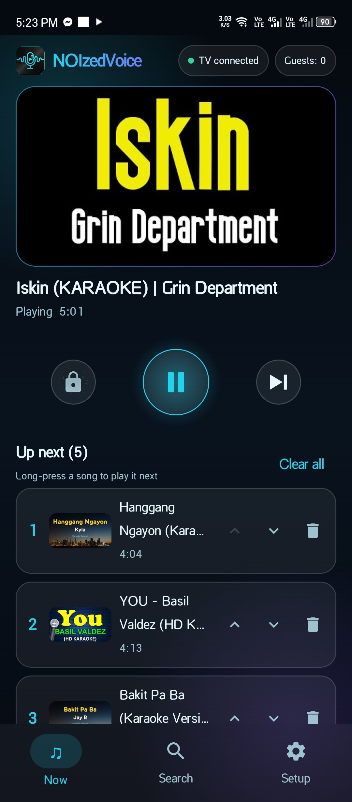
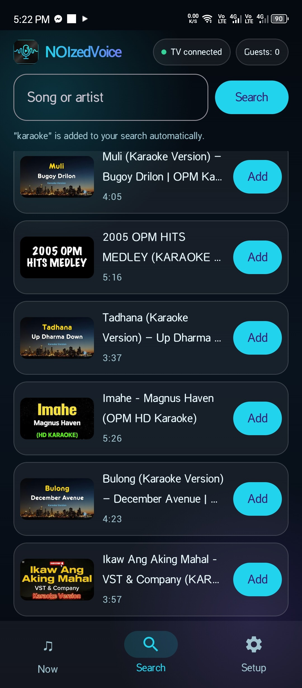
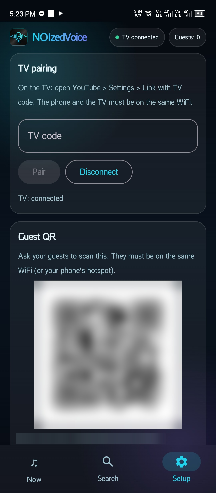

# NOIzedVoice - YouTube Karaoke Remote

Run a karaoke night from your phone. The host phone remote-controls the **YouTube app on your TV**, and guests add songs from their own phones by scanning a QR code. No PC, no casting delay, and guests don't install anything.

> Unofficial project. Not affiliated with, endorsed by, or sponsored by YouTube or Google. See [Limitations](#limitations).

## Features

- **Direct TV remote:** pairs with the YouTube app on your TV using the TV code (the same way the official phone remote does).
- **Guest web page:** guests scan a fixed QR code, then search and add songs in their browser.
- **Queue:** automatic next song, no duplicates, reorder, remove, play next, clear, and lock.
- **Skip Ad:** a red Skip Ad strip appears only while an ad plays, and becomes active once the ad is skippable.
- **Search without an API key:** YouTube results with "karaoke" added automatically.
- **Runs entirely on the host phone:** a built-in web server and a foreground service keep it running while the screen is off.

## Screenshots

  
  
  

## Download

[**NOIzedVoice-Remote.apk (v1.0.0)**](https://github.com/noi520/NOIzedVoice-YTKaraoke-Remote/releases/download/v1.0.0/NOIzedVoice-Remote.apk)

Requires Android 7.0 (API 24) or newer. You may need to allow installing apps from unknown sources.

## How to use

**Host (the phone that controls the TV)**

1. Install the APK and open the app.
2. On the TV, open the **YouTube** app, go to **Settings > Link with TV code**, and note the code.
3. In the app, open the **Setup** tab, enter the TV code, and tap **Pair**. When you see "TV: connected", you're ready.
4. Make sure the phone and the TV are on the **same WiFi**.
5. Still in **Setup**, show the **Guest QR** to your guests.

**Guests**

1. Join the same WiFi (or the host phone's hotspot).
2. Scan the QR code and open the page.
3. Search for a song and tap **Add**.

The QR code contains the host phone's current IP address. If the WiFi changes, tap **Refresh QR** in Setup.

## Limitations

- It uses YouTube's **unofficial Lounge API** and reads YouTube search pages. It may stop working if YouTube changes something.
- **Unskippable ads cannot be skipped.** The Skip Ad button only works when YouTube allows skipping. YouTube Premium on the TV avoids ads entirely.
- The queue is kept in memory and resets when the app is closed.
- The host phone must stay on, with the app running, during the session.

## Build from source

1. Open the project in **Android Studio** and let Gradle sync.
2. Run the app, or use **Build > Build APK(s)**.

Built with Kotlin, Jetpack Compose, OkHttp, NanoHTTPD, ZXing, and Coil.

## Credits

The Lounge protocol handling is a Kotlin port based on the ideas of the open-source [pyytlounge](https://github.com/FabioGNR/pyytlounge) library.

## License

[MIT](LICENSE)
